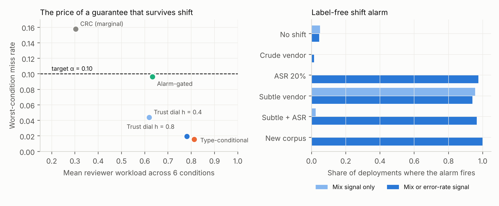

# ScribeCheck

**Trust That Survives Deployment: Shift-Robust Review Guarantees for AI Medical Scribes**

Kishore Nuthalapati · preprint, November 2026

**[Project page](https://kishoren18-hue.github.io/scribecheck/) · [Paper (PDF)](paper/scribecheck_paper.pdf) · [LaTeX source](paper/main.tex)**

## Abstract

AI medical scribes write clinical notes from doctor-patient conversations, and their safety rests on a clinician reviewing each note. Conformal risk control (CRC) can tell that reviewer which sentences to check while bounding the expected share of errors left unflagged, but the bound assumes the notes at deployment look like the notes used to calibrate it. A scribe deployment breaks that assumption: vendors update models, microphones and accents change the transcript, and a hospital's cases differ from any benchmark.

We build **ScribeErr**, 11,996 corrupted notes from ACI-Bench and MTS-Dialog with 11 transcript-aware error types, including *grounded* errors in which every word was spoken during the visit but the meaning is wrong. We stress-test CRC review gates under eight deployment shifts, propose **type-conditional review guarantees** and a **label-free shift alarm** that keep the guarantee when the error mix changes, and audit 1,200 real notes from ten note writers. Five findings:

1. **A valid guarantee can hide a blind spot.** In distribution, CRC meets its target (miss rate 0.098 at α = 0.10) while missing 26.5% of grounded errors, mostly negation flips, and 0.4% of invented ones.
2. **A shift in error mix breaks the guarantee; transcript noise does not.** A vendor whose errors skew subtle pushes the miss rate to 0.155, violating the target in 97% of 300 resplits. ASR noise keeps it valid but raises reviewer workload from 28% to 41% of sentences.
3. **Type-conditional guarantees survive any error mix.** Bounding the miss rate inside each error family bounds it for every mixture of families. Across six conditions and 200 resplits it never exceeded 0.016, where marginal CRC failed in three conditions. Its price is set by the worst-detected family: 80% workload, almost entirely because of negation flips; without that family it costs the same as marginal CRC.
4. **A label-free alarm says when to pay that price.** Estimating the deployment error mix and error rate from unlabeled notes, the alarm fires in 94% to 100% of deployments with a harder error mix, transcript noise or a new corpus, in 1.5% when the shift makes errors easier, and in 4.5% when nothing has shifted. Switching to the type-conditional gate only when it fires keeps the miss rate at or below 0.025 under every shift while costing 30% workload when nothing has shifted.
5. **A verified report card on real outputs.** Transcript checks with 93% adjudicated precision find an invented drug, dose or side in 15% of GPT-4 notes against 1.7% of human reference notes, and a transcript-to-note certainty audit finds models turning the clinician's hedged diagnoses into certain ones where human notes did not (pilot, 23 diagnoses).

The result reframes the reviewer's question from "how often does the scribe err?" to "which errors am I guaranteed to see, and when has that stopped being true?"



## Gates at a glance (α = 0.10, 200 resplits, miss rate / reviewer workload)

| Gate | No shift | Crude vendor | ASR 20% | Subtle vendor | Subtle + ASR | New corpus |
|---|---|---|---|---|---|---|
| CRC (marginal) | 0.100 / 28% | 0.023 / 28% | 0.091 / 32% | **0.158** / 27% | **0.138** / 31% | **0.109** / 36% |
| Trust dial, h = 0.4 | 0.030 / 60% | 0.005 / 60% | 0.031 / 62% | 0.044 / 59% | 0.035 / 62% | 0.020 / 69% |
| Type-conditional (TC-CRC) | 0.015 / 80% | 0.000 / 80% | 0.015 / 81% | 0.016 / 80% | 0.015 / 81% | 0.002 / 84% |
| Alarm-gated | 0.096 / 30% | 0.023 / 29% | 0.017 / 80% | 0.025 / 78% | 0.019 / 80% | 0.002 / 84% |

## Error taxonomy (ScribeErr)

| Family | Types |
|---|---|
| Invented (ungrounded) | `U_DOSE` `U_NUM` `U_MED` `U_LAT` `U_TIME` `U_FAB` |
| Negation (grounded words, reversed meaning) | `NEG_FLIP` |
| Grounded binding | `G_NUM` `G_MED` `G_LAT` `RETRACT` (clinician retracts a plan the note still records) |

## Run it

```bash
pip install -r requirements.txt
./run_all.sh          # ~50 min on 2 CPU cores, no GPU, no API keys
```

| Script | What it does |
|---|---|
| `01_build_benchmark.py` | ScribeErr instances |
| `02_featurize.py`, `03_train_detector.py` | evidence features and auditors (`results/detector_quality.csv`) |
| `04_experiments.py 300` | marginal CRC gates under 8 shifts (`shift_summary.csv`, `recalibration.csv`, `miss_by_type.csv`) |
| `10_polarity_features.py` | term-anchored polarity features, SC+N and SC+RN auditors |
| `09_shift_aware.py 200 SC` | type-conditional gates, trust dial, shift alarm, alarm-gated policy |
| `05_real_scribes.py` | report card on real system outputs (`report_card.csv`, `real_epistemic_claims.csv`) |
| `06_adjudication_sheet.py` | the sheet `results/hardcheck_labels.csv` was labeled on |
| `07_figures.py` | `figures/` |
| `08_labeling_kit.py build / score` | blinded clinician sheets and Krippendorff's alpha |

## Library

```python
from scribecheck import hardchecks as H, epistemic as E
v = H.Visit(transcript)                                    # "[doctor] ...\n[patient] ..."
H.check_sentence("Continue atorvastatin 80 mg daily.", v)  # [('DOSE_UNSAID', 'atorvastatin 80')]
E.audit_note([("ap", "Rotator cuff tendinopathy.")], transcript, E.build_dx_vocab())
```

## Limits

Injected errors are controlled, not natural. Adjudications so far were done against transcripts by the author with AI assistance, not by clinicians; the labeling kit is the next step. Type-conditional guarantees rest on a label-shift assumption. The real outputs come from 2023-era models on role-played visits.

## Related work

CARE (Bedi, Lin et al., 2026), conformal flags for medical summaries · Possible or Definite? (Du et al., MLHC 2026), uncertainty preservation · One note in three (Fox et al., 2026), a census of commercial scribes · Alexandari et al. (2020) and Saerens et al. (2002), label-shift estimation · ACI-Bench and MTS-Dialog (data).

## License

Code: MIT (see `LICENSE`). Data: ACI-Bench and MTS-Dialog are CC BY 4.0; see their repositories.
